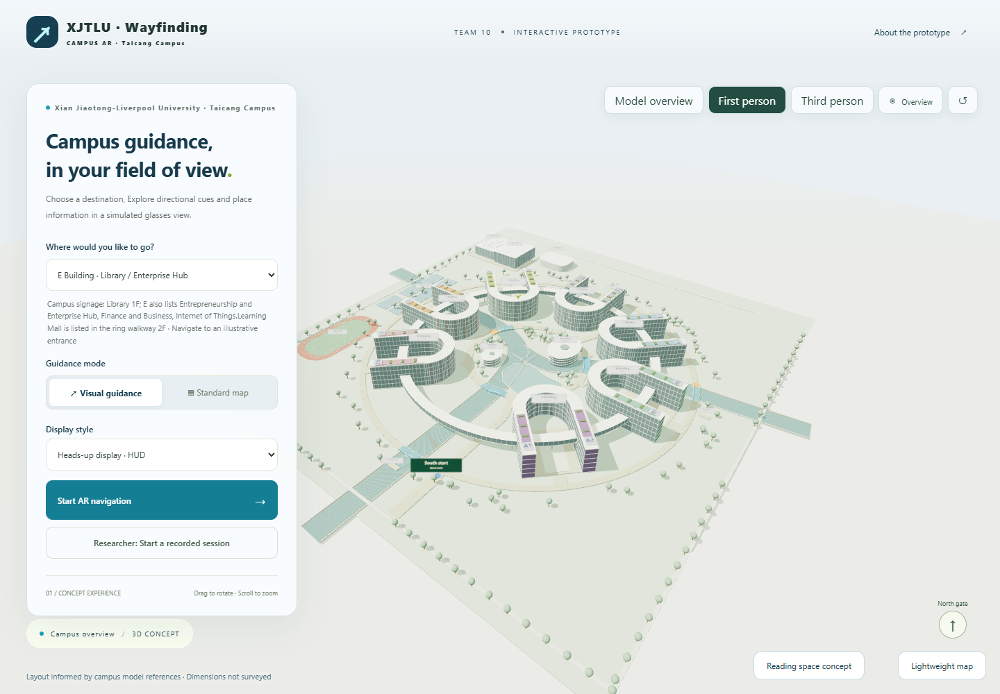
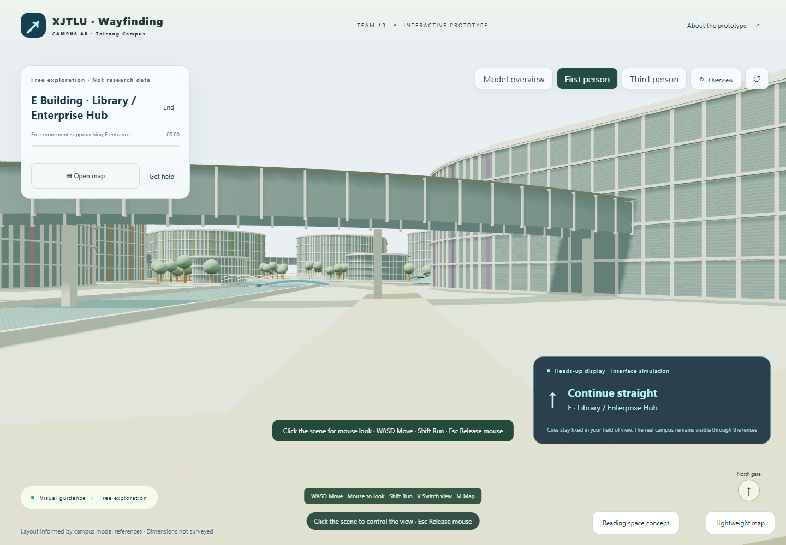

# Team 10 — Campus AR Guide Evidence

**Rokid: AR Application Challenge (July)** · XJTLU Taicang Campus · ENT303TC · Weeks 1–8

An indexed public evidence archive for the team presentation. Start with the English screenshots for a visual overview, then follow the weekly sources below.

**[Open the demo](https://raymondhuang31.github.io/taicang-ar-campus-team10/?v=0.6.0)** · **[English visual evidence](english-visual-evidence/README.md)** · **[Prototype source and history](https://github.com/RaymondHuang31/taicang-ar-campus-team10)**

**[Evidence ID index: EV-001–EV-023](EVIDENCE_INDEX.md)**

## Evidence by week

| Week | Focus | Records |
| --- | --- | --- |
| 1 | Initial assumptions and research readiness | [Open Week 1](weeks/week-01/README.md) |
| 2 | Problem framing and revised assumptions | [Open Week 2](weeks/week-02/README.md) |
| 3 | Competitors, market model and USP hypothesis | [Open Week 3](weeks/week-03/README.md) |
| 4 | Research design, recruitment and consent planning | [Open Week 4](weeks/week-04/README.md) |
| 5 | Research synthesis and limitations | [Open Week 5](weeks/week-05/README.md) |
| 6 | Insights, journey and direction decision | [Open Week 6](weeks/week-06/README.md) |
| 7 | Alternative concepts, weighted comparison and staged Rokid direction | [Open Week 7](weeks/week-07/README.md) |
| 8 | Business model, claim-evidence map and HUD plan | [Open Week 8](weeks/week-08/README.md) |

## Visual evidence

The six member panels and fifteen individual captures are retained with their source notes. These show the prototype, implementation, research instruments, actual version differences, release history and demonstration QA.

## Read the claims in context

- **Current output:** a browser demonstration and research/design records. **Intended next stage:** Rokid glasses HUD guidance.
- Week 5 user-research summaries are separate from the screenshot package's automated demo metrics. Neither establishes a tested Rokid wearable benefit.
- Earlier files may contain superseded hypotheses. Preferred v2 records are listed first; retained v1 versions are in `archive` folders.
- Commercial assumptions, unresolved research gaps and technical limits remain visible. This archive does not certify every claim in the source files.
- Participant-level records remain in team-only storage; [public-scope and provenance notes](PUBLICATION_NOTES.md) explain the omissions.

Source snapshot: **4 November 2026**. Read Office files as the source artefacts; Markdown previews are provided for quick viewing on GitHub.
