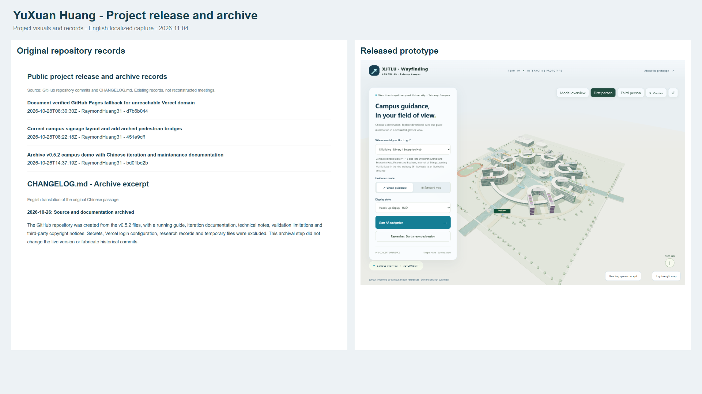
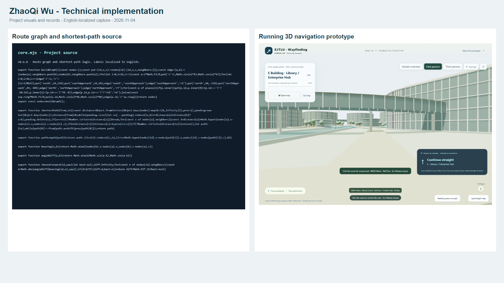
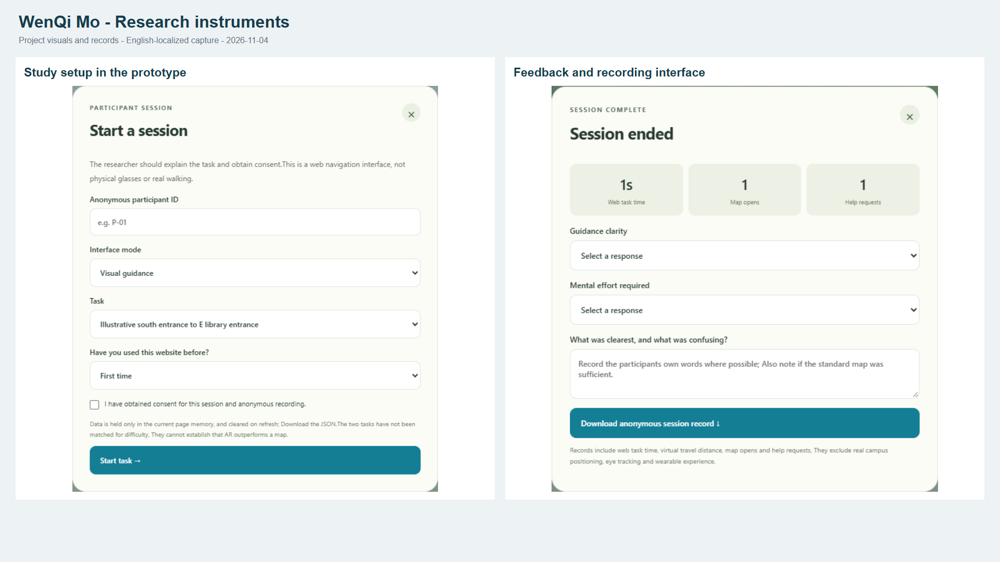
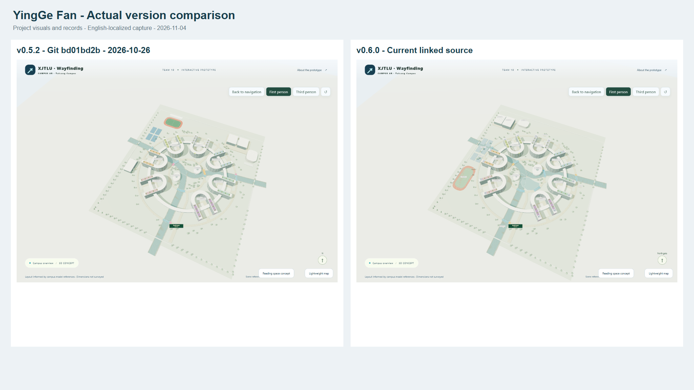
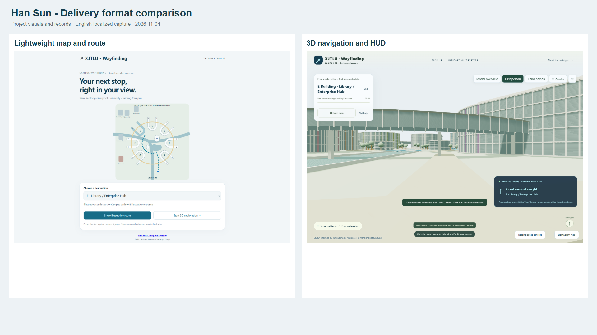
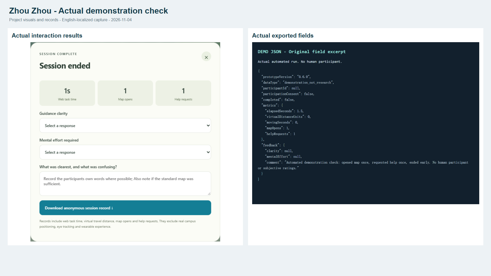

# Team 10 Project Evidence

English-language screenshots of the Taicang campus wayfinding prototype.

## Member evidence images

### YuXuan Huang

Project release and archive

### ZhaoQi Wu

Technical implementation

### WenQi Mo

Research instruments

### YingGe Fan

Actual version comparison

### Han Sun

Delivery format comparison

### Zhou Zhou

Actual demonstration check

## Source and attribution

Captured on 2026-11-04. Original project source was rendered locally. Interface labels were translated into English for these images, with minor spacing adjustments. The online project was not modified. Model geometry and navigation logic were retained.

- [Current prototype](https://raymondhuang31.github.io/taicang-ar-campus-team10/?v=0.6.0)
- [Historical v0.5.2 source snapshot](https://github.com/RaymondHuang31/taicang-ar-campus-team10/tree/bd01bd2bc0e9949fb0841317c1c8457e3f42eb4e)
- [Public release records](https://github.com/RaymondHuang31/taicang-ar-campus-team10/commits)

The historical comparison uses actual source snapshots. The archive passage in the release-record image is an English translation; original English commit messages are preserved.

Member names are matched to responsibilities in the team presentation. Repository records identify an account, not internal ownership. Personal attribution must reflect the work actually performed.

Research images show implemented research instruments, not completed interviews. Result and export images are from an automated demonstration with one map open, one help request and early exit, without a human participant or subjective ratings. The delivery-format comparison shows available display options; it is not evidence of completed pricing, cost or market research.

Bottom explanatory captions have been removed from the six composite images. These source and interpretation notes remain here for context. The remaining 15 images are individual source and runtime captures.
